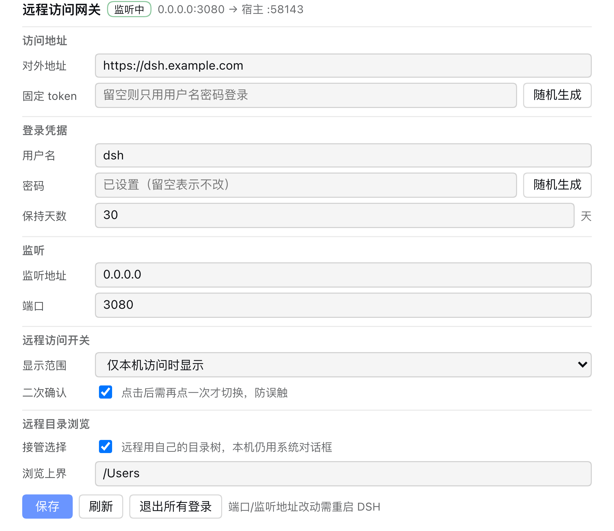

# dsh-reverse-proxy-gateway

**English** · [简体中文](README.md)

Expose the DSH (DeepSeek Harness) desktop app's local web UI to the internet, safely. Open your own domain from a phone or any other machine and you get **the same session on the same machine**, not a second instance.

The gateway listens on its own fixed port inside the DSH process, leaves the host's random loopback port alone, and on every forwarded request rewrites `Host` and signs a fresh host session cookie — so **you don't need to touch `trustedHosts`, and you don't need to stretch `cookieMaxAgeDays`**.



## Features

- Fixed-port listener inside the process; follows the host's random port across DSH restarts
- Basic Auth, passwordless token links, revocable long-lived login cookies
- Failed-login throttling, origin checks, login audit; HTTP and WebSocket share one gate
- WebSocket upgrades and streaming responses
- Remote "create workspace" uses an in-browser directory tree instead of the host's native dialog
- Configurable from a settings section, a plugin detail card, and the composer icon

## Install

**Desktop:** Settings → Plugins → Install, enter `git+https://github.com/xiongking/dsh-reverse-proxy-gateway.git`, then restart DSH.

**CLI** (non-managed profiles such as `web`):

```bash
dsh plugin --profile web add "git+https://github.com/xiongking/dsh-reverse-proxy-gateway.git"
```

The `desktop` profile is owned by the desktop app and can't be managed from the CLI.

## Use

1. **Set credentials** — Settings → Remote access, enter a username and password (8+ characters), save. Password and token: at least one is required, otherwise the gateway won't listen.
2. **Point a reverse proxy at it** — a router, nginx, Caddy or Cloudflare Tunnel all work; target `host-ip:3080`. The one hard requirement is to **preserve the original `Host` header**; rewriting it to `127.0.0.1` will be rejected. Terminate TLS at that layer.
3. **Fill in the public URL** — same page, "Public URL", e.g. `https://dsh.example.com`. Used for passwordless links, status display and origin checks.
4. **Sign in** — open that URL and enter the credentials from step 1. Cookies keep you signed in; no re-login after a refresh or a background/foreground switch.

Find your LAN IP: `ifconfig | grep "inet " | grep -v 127.0.0.1`

## Configuration

| Key | Default | Description |
|---|---|---|
| `enabled` | `true` | Master switch; turning it off stops listening |
| `listen` | `"0.0.0.0"` | Bind address. Use `127.0.0.1` if only a local proxy connects |
| `port` | `3080` | Listen port the proxy points at |
| `publicUrl` | `""` | Public URL; separate multiple entries with commas or spaces |
| `username` | `"dsh"` | Basic Auth username |
| `password` | `""` | Basic Auth password, 8+ characters |
| `accessToken` | `""` | Fixed token; `publicUrl?token=<value>` signs in without a password |
| `cookieDays` | `30` | Gateway cookie lifetime in days |
| `switchMode` | `"local"` | Where the composer icon shows: `local` / `always` / `never` |
| `confirmToggle` | `true` | First click only arms; a second confirms |
| `remotePicker` | `true` | Use an in-browser directory tree for remote "create workspace" |
| `browseRoot` | `""` | Upper bound for remote browsing; empty means your home directory |

Changing `port` or `listen` needs a DSH restart; everything else applies on save. UI changes are written to `~/.dsh/.dsh-reverse-proxy-gateway.json` (mode 600) and override the profile config.

**The globe icon next to the composer** shows state by colour: green = on and listening, grey = off, amber = on but not listening (port taken, or neither password nor token set). Clicking toggles it without a restart. `switchMode` defaults to `local` — shown only when you open DSH on this machine, because clicking it remotely would cut the very connection you are using.

**Remote directory picking:** by default DSH opens the host's native folder dialog, which a remote browser never sees. With `remotePicker` on, the gateway injects a small script into `<head>` that takes over that entry point, so remote sessions get an in-browser tree while local sessions keep the native dialog. `browseRoot` sets the **upper bound** only; the tree always starts at your home directory, so `/Users` lets you walk up one level. Only directories are listed, paths are `realpath`-resolved before comparison, and symlinks can't escape.

## Security

DSH has **full shell access and read/write access to the whole disk**. If this gateway falls, the machine falls with it.

**Every request passes three gates** (identical for HTTP and WebSocket):

1. **Lockout** — five failures from one source within five minutes locks it for five minutes and returns `429`. Sources are counted on two keys, the TCP peer **and** the first hop of `X-Forwarded-For`, and the forwarding header is only trusted when the peer itself is loopback or private. Repeats of the same credential within five seconds count once, so a browser replaying cached Basic credentials for every subresource can't lock you out.
2. **Origin** — `Sec-Fetch-Site: cross-site`, or an `Origin` matching neither `Host` nor any `publicUrl` entry, is rejected. The three `/__dshgw/*` routes served by the plugin itself get no host-side fence, so this gate covers them.
3. **Credentials** — gateway cookie, fixed token, or Basic Auth. The host session cookie is re-signed on every forward; whatever the browser sent is discarded.

Only genuine credential failures are counted; a bare `401` without credentials is not.

**Revocation** — the gateway cookie is bound to a credential fingerprint (`username` + `password` + `accessToken`) and a rotatable session epoch. Changing any credential, or pressing **Sign out everywhere**, invalidates every cookie issued before that moment.

**Audit** — logins, failures, lockouts, cross-site rejections and sign-outs are appended as JSONL to `~/.dsh/.dsh-reverse-proxy-gateway.audit.<profile>.log`, rotated at 5 MB across `.1`…`.3`.

**Known limitation** — signing in to a DeepSeek account doesn't work through the gateway: upstream registers `/oauth/callback` on the host web server and validates `state` against the bound loopback address, which a remote browser can't reach. Workarounds: sign in locally, forward the loopback port over `ssh -L`, or use the API key channel. Everything else works.

**Never expose `0.0.0.0:3080` to the internet directly.** Terminate TLS at a router or tunnel, and add another auth layer there if you can.

## Troubleshooting

| Symptom | Fix |
|---|---|
| 502 / can't connect from outside | Gateway isn't listening. Check `enabled` and that `password` is set; `EADDRINUSE` in the log means the port is taken |
| 403 from outside | The proxy rewrote `Host`; make it preserve the original header |
| Bounced back to the login page | Private browsing or blocked cookies; or `cookieDays` is too small |
| Changing `port` has no effect | Port and bind address need a DSH restart |
| Icon is amber | On but not listening: port taken, or neither password nor token set |
| Remote "create workspace" does nothing | With `remotePicker` off the dialog opens on the host's screen; turn it on |
| Can't walk up in the tree | You're at `browseRoot`; widen it (e.g. `/Users`, `/`) |

## Design tradeoffs

<details>
<summary>Why some things look more roundabout than they need to be (expand)</summary>

**Self-signed session cookies instead of exchanging a ticket.** The host signs its session cookie for the authority `127.0.0.1:<random port>`, so forwarding the browser's cookie would fail the moment the authority differs. Exchanging a launch token for a ticket works, but the ticket is pinned to the port it was minted on: every DSH restart needs a new one, and there's a window during cold start where nothing works. Signing a fresh cookie per forward follows the port automatically; the cost is reading `~/.dsh/.credentials.yaml`, which is equivalent in privilege since the gateway runs in the same process.

**Deleting `Origin` / `Referer` instead of rewriting them to loopback.** Rewriting to `http://127.0.0.1:<port>` also satisfies the host's same-origin check, but it forges the origin and gives away the browser's cross-site protection. Deleting them leaves the request with no origin, and the gateway's own origin check is stricter anyway.

**Injecting a script instead of patching the host's frontend bundle.** Intercepting `/plugins/@deepseek-ai/dsh-client-connection/client.js` to flip the check works too, but depends on internal file paths and minified function names — it can silently break on any DSH upgrade, and it changes what "is this the local machine" means everywhere, including the settings page. Injection takes over exactly one seam, `__DSH_DIRECTORY_PICKER__`; the worst case is falling back to the original behaviour.

**Deciding "remote" from the TCP peer only, never from `X-Forwarded-For`.** Anyone can write that header, so trusting it lets the other side declare its own identity. The cost: if another proxy runs on the same machine in front of the gateway (making the peer loopback), a local visit is misread as remote — the composer icon hides and the page gets the directory script. Put that extra layer on a different machine.

**A failed epoch write is accepted.** If the epoch file (`~/.dsh/.dsh-reverse-proxy-gateway.sessions.<profile>.json`) can't be written, the gateway logs a warning and keeps the new value in memory; after a restart a fresh epoch is generated and every issued login is invalidated. Better than treating a possibly-revoked epoch as still valid.

**Inject only for remote visitors.** The native dialog can reach network shares, create folders and has a sidebar; there's no reason to force local sessions through a web tree.

</details>

## Uninstall

Disable or remove the plugin, then delete `~/.dsh/.dsh-reverse-proxy-gateway.json`.

## License

MIT
