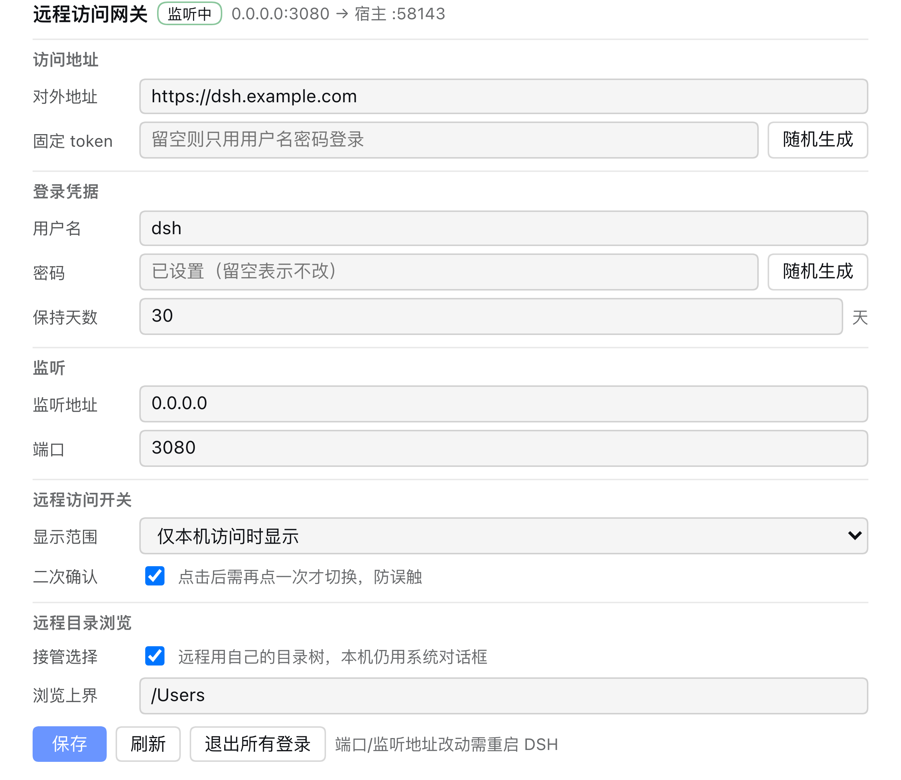

# dsh-reverse-proxy-gateway

**简体中文** · [English](README.en.md)

把 DSH（DeepSeek Harness）桌面版的本地 Web 服务安全地反代到公网。装好后用自己的域名从手机或任意电脑访问，**看到的是同一台机器上的同一个会话**，不是另开一个实例。

网关在 DSH 进程内另起一个固定端口，不动宿主原本的随机回环端口；转发时重写 Host 并现签一条宿主会话 cookie，所以**不需要改 `trustedHosts`，也不需要拉长 `cookieMaxAgeDays`**。



## 功能

- 进程内固定端口监听，自动跟随 DSH 重启后的随机端口
- Basic Auth、固定 token 免密链接、可吊销的长期登录 cookie
- 认证失败限速、来源校验、登录审计；HTTP 与 WebSocket 走同一套判定
- 支持 WebSocket upgrade 与流式响应
- 远程「创建工作区」用浏览器内的目录树代替主机上的系统对话框
- 设置页分组、插件详情页卡片、输入框旁图标，三处都能配置和开关

## 安装

**桌面版**：设置 → 插件 → 安装，填 `git+https://github.com/xiongking/dsh-reverse-proxy-gateway.git`，装完重启 DSH。

**命令行**（`web` 等非托管 profile）：

```bash
dsh plugin --profile web add "git+https://github.com/xiongking/dsh-reverse-proxy-gateway.git"
```

`desktop` profile 由桌面应用独占，命令行管不了，请用图形界面。

## 使用

1. **设凭据** —— 设置 → 远程访问，填用户名和密码（至少 8 位），保存。密码与固定 token 至少留一项，否则网关不监听。
2. **接反代** —— 路由器、nginx、Caddy、Cloudflare Tunnel 都行，目标填 `本机IP:3080`。唯一硬要求是**保留原始 Host 头**，改写成 `127.0.0.1` 会被地址校验拒绝。TLS 建议在这一层终止。
3. **填对外地址** —— 同一页面填「对外地址」，例如 `https://dsh.example.com`。它用于拼接免密链接、状态展示与同源校验。
4. **登录** —— 浏览器打开该地址，输第 1 步的凭据。之后凭 cookie 直通，手机刷新、切后台都不用再登。

本机内网 IP：`ifconfig | grep "inet " | grep -v 127.0.0.1`

## 配置

| 键 | 默认 | 说明 |
|---|---|---|
| `enabled` | `true` | 总开关，关掉即停止监听 |
| `listen` | `"0.0.0.0"` | 监听地址。只让本机反代连入填 `127.0.0.1` |
| `port` | `3080` | 监听端口，反代指向这里 |
| `publicUrl` | `""` | 对外地址；多个入口用逗号或空格分隔 |
| `username` | `"dsh"` | Basic Auth 用户名 |
| `password` | `""` | Basic Auth 密码，至少 8 位 |
| `accessToken` | `""` | 固定 token，访问 `publicUrl?token=该值` 免密登录 |
| `cookieDays` | `30` | 网关 cookie 有效期（天） |
| `switchMode` | `"local"` | 输入框旁图标的显示范围：`local` / `always` / `never` |
| `confirmToggle` | `true` | 点一下只是待确认，再点一下才真正切换 |
| `remotePicker` | `true` | 远程访问时用网页内目录树接管「创建工作区」 |
| `browseRoot` | `""` | 远程目录浏览的上界，留空表示主目录 |

`port` 与 `listen` 改动需重启 DSH，其余保存即生效。界面上的改动写入 `~/.dsh/.dsh-reverse-proxy-gateway.json`（权限 600），优先级高于 profile 里的静态配置。

**输入框旁的地球图标**颜色即状态：绿＝开着且在监听，灰＝已关闭，橙＝开着但没监听（端口被占用，或密码与 token 都为空）。点一下即启停，不用重启。`switchMode` 默认 `local`，只在从本机打开时显示——远程那端点一下就把网关关了，等于当场切断自己这条连接。

**远程目录浏览**：点「创建工作区」时 DSH 默认调主机上的系统对话框，远程浏览器里什么都不会发生。开启 `remotePicker` 后网关往 `<head>` 插一小段脚本，接管这个入口，远程改用网页内的目录树；本机仍用系统对话框。`browseRoot` 只定**上界**，起点始终是自己的家目录，所以填 `/Users` 就能从家目录往上退一级。网关只列子目录，路径先 `realpath` 再比对，符号链接跳不出去。

## 安全

DSH 拥有**整机 shell 与全盘读写权限**。这层网关失守，等同于交出这台机器。

**每个请求都要过三道关**（HTTP 与 WebSocket 一致）：

1. **锁定** —— 同一来源 5 分钟内失败 5 次，锁 5 分钟，回 `429`。来源按 TCP 对端**与** `X-Forwarded-For` 首段双键计数，转发头只在对端本身是回环或私有网段时才采信。同一份凭据 5 秒内重复提交只算一次，避免浏览器把缓存凭据重发到每个子资源时把你自己锁在门外。
2. **同源** —— `Sec-Fetch-Site: cross-site`，或 `Origin` 既不等于 `Host` 也不等于 `publicUrl` 里任一入口，一律拒绝。插件自己处理的三个 `/__dshgw/*` 接口拿不到宿主的围栏，靠这一层兜住。
3. **凭据** —— 网关 cookie、固定 token、Basic Auth 三选一。转发时重新签发宿主会话 cookie，浏览器自带的宿主 cookie 一律丢弃。

只有「确实提交了凭据但不对」才计数；不带凭据的裸 `401` 不计数。

**吊销** —— 网关 cookie 绑定凭据指纹（`username` + `password` + `accessToken`）与一个可轮换的会话世代。改任一凭据，或在设置里点**退出所有登录**，此前签发的 cookie 立即作废。

**审计** —— 登录成功、失败、锁定、跨站拒绝、退出所有登录都以 JSONL 追加到 `~/.dsh/.dsh-reverse-proxy-gateway.audit.<profile>.log`，超过 5 MB 按 `.1`…`.3` 轮流保留三代。

**已知限制** —— 经网关无法完成「登录 DeepSeek 账号」：上游把 `/oauth/callback` 注册在宿主 web server 上并按绑定回环地址校验 `state`，远程浏览器的回调打不到那个监听。绕法是在本机登录、用 `ssh -L` 转发回环端口，或改用 API Key。其余功能不受影响。

**别把 `0.0.0.0:3080` 直接暴露到公网**。至少由路由器或隧道终止 TLS，并尽量在那一层再加一层认证。

## 排错

| 现象 | 处理 |
|---|---|
| 外部 502 / 连不上 | 网关没监听。看 `enabled` 是否开、`password` 是否为空；端口占用时日志有 `EADDRINUSE` |
| 外部 403 | 反代改写了 Host 头，设成「保留原始 Host」 |
| 登录后又跳回登录页 | 隐私模式或 cookie 被拦；或 `cookieDays` 太小 |
| 改 `port` 不生效 | 端口与监听地址需重启 DSH |
| 图标是橙色 | 开着但没监听：端口被占用，或密码与 token 都为空 |
| 远程点「创建工作区」没反应 | `remotePicker` 关着时对话框开在主机屏幕上，把它打开 |
| 目录树退不到更上层 | 已经贴着 `browseRoot`，把它放宽（如 `/Users`、`/`） |

## 设计取舍

<details>
<summary>几处看起来「绕」的做法背后的原因（点开）</summary>

**自签会话 cookie，而不是向宿主换票。** 宿主的会话 cookie 签在 `127.0.0.1:<随机端口>` 这个 authority 上，authority 一变签名就失效。可以拿 launch token 换一张票，但那张票绑死在换票时的端口上，DSH 重启就得重换，冷启动窗口期还会整段不可用。改成每次转发现签一条，端口变化自动跟随，代价是要能读 `~/.dsh/.credentials.yaml`（本来就和 DSH 同进程，权限等价）。

**删掉 Origin / Referer，而不是改写成回环。** 改写成 `http://127.0.0.1:<port>` 也能过宿主的同源校验，但那是伪造来源，等于把浏览器的跨站保护整个让掉。删掉让宿主看到「没有来源」，配合网关自己的来源校验反而更严。

**注入脚本，而不是 patch 宿主前端包。** 拦截 `/plugins/@deepseek-ai/dsh-client-connection/client.js` 改判断也能用，但依赖宿主内部文件名与压缩后的函数名，升级即可能静默失效，还会改变「是不是本机」的语义、波及设置页。注入只接管 `__DSH_DIRECTORY_PICKER__` 这一个 seam，最坏结果是退回原行为。

**「是不是远程」只看 TCP 对端，不看 `X-Forwarded-For`。** 转发头谁都能写，据此判断等于让对面自己声明身份。代价是：网关前面若还有一层跑在同一台机器上的反代（对端变成回环），本机会被误判成远程——表现为开关被隐藏、页面被注入目录脚本。多层反代请把那一层放到另一台机器上。

**会话世代写盘失败就认了。** 世代文件（`~/.dsh/.dsh-reverse-proxy-gateway.sessions.<profile>.json`）落盘失败只记警告、本次仍用内存新值，结果重启后换新世代、此前登录全失效。宁可让所有人重登，也不要把可能已被吊销的世代当有效值。

**只对远程注入，本机保持原样。** 本机的系统对话框能访问网络盘、能新建、有侧边栏，没必要为了统一让本机也走网页树。

</details>

## 卸载

停用或移除插件，再删掉 `~/.dsh/.dsh-reverse-proxy-gateway.json`。

## 许可

MIT
